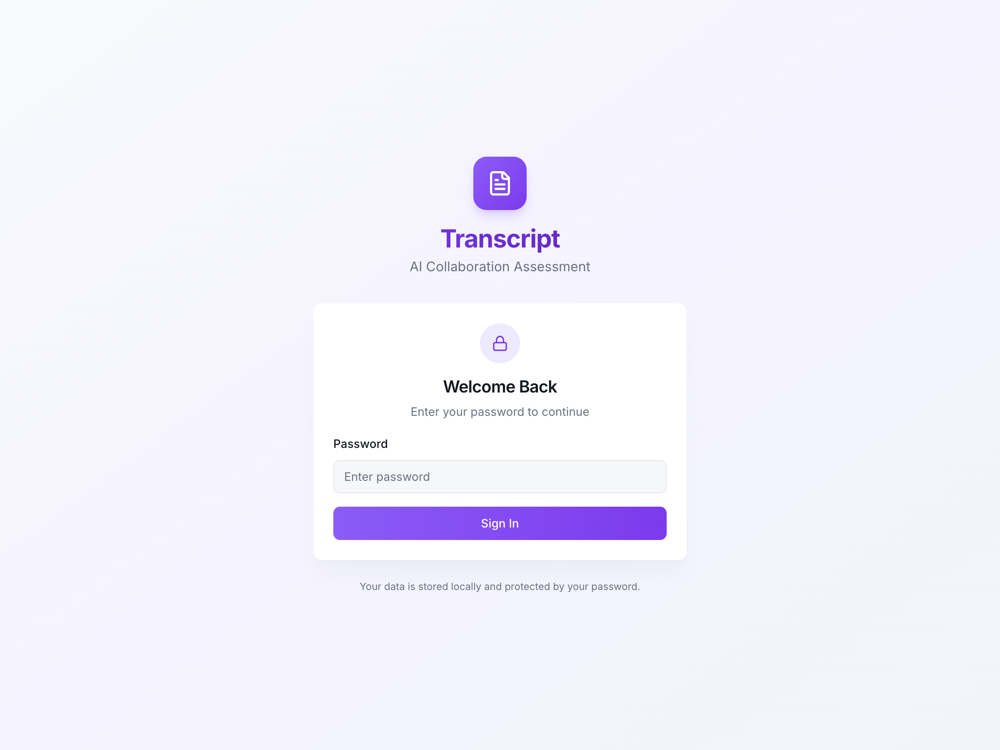
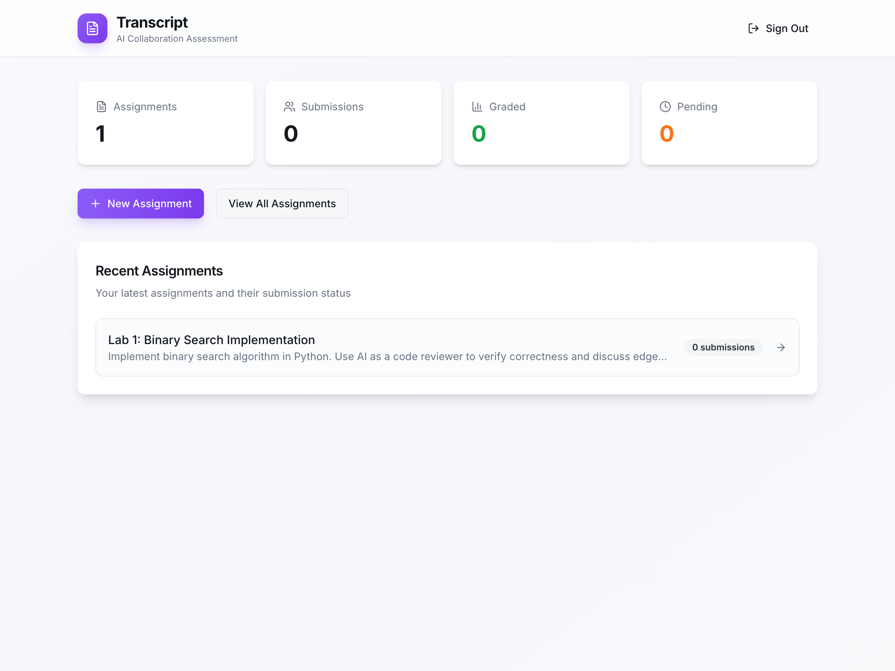
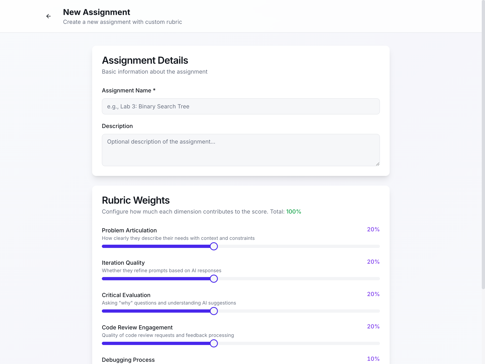
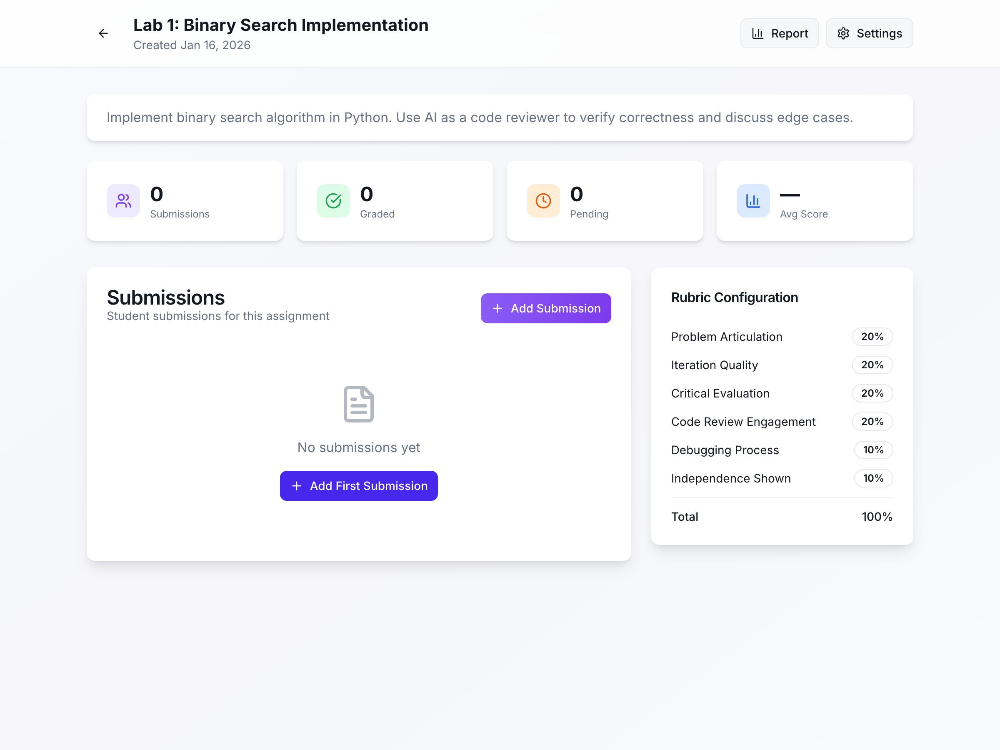
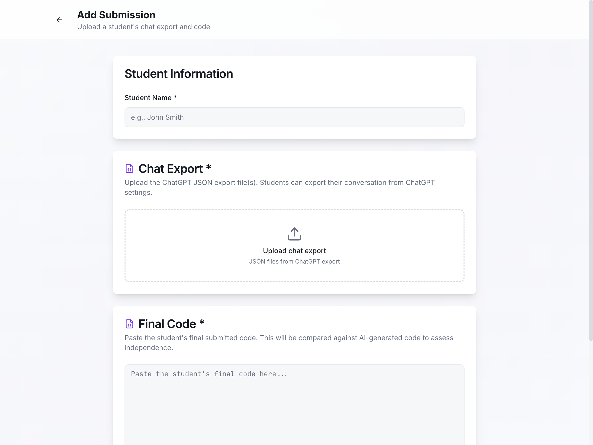
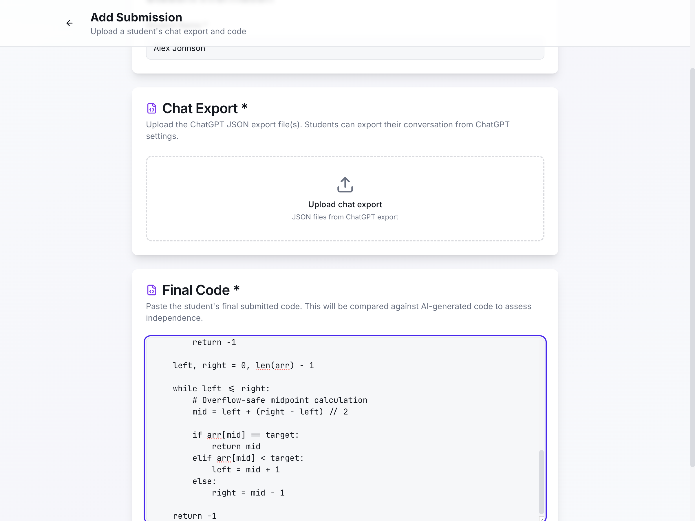

# Transcript User Guide

**AI Collaboration Assessment for Educators**

Transcript helps educators assess how effectively students collaborate with AI tools like ChatGPT. Instead of asking "Did they use AI?", Transcript asks "How well did they use AI?"

---

## Table of Contents

1. [Getting Started](#getting-started)
2. [Dashboard Overview](#dashboard-overview)
3. [Creating Assignments](#creating-assignments)
4. [Adding Student Submissions](#adding-student-submissions)
5. [Reviewing Submissions](#reviewing-submissions)
6. [Understanding the Rubric](#understanding-the-rubric)
7. [Generating Reports](#generating-reports)
8. [How Students Export ChatGPT Logs](#how-students-export-chatgpt-logs)

---

## Getting Started

### First-Time Setup

1. Navigate to `http://localhost:3001` in your browser
2. On first visit, you'll be prompted to create a password
3. This password protects your local data

### Logging In

After setup, enter your password to access the dashboard.



> **Note:** Your data is stored locally on your computer. The password protects access to the application.

---

## Dashboard Overview

The dashboard provides a quick overview of your grading workload:



### Statistics Cards

| Card | Description |
|------|-------------|
| **Assignments** | Total number of assignments created |
| **Submissions** | Total student submissions across all assignments |
| **Graded** | Submissions you've reviewed and scored |
| **Pending** | Submissions awaiting your review |

### Quick Actions

- **New Assignment** - Create a new assignment with custom rubric
- **View All Assignments** - See complete list of assignments
- **Recent Assignments** - Click any assignment to view details

---

## Creating Assignments

### Step 1: Click "New Assignment"

From the dashboard, click the purple **+ New Assignment** button.

### Step 2: Fill in Assignment Details



| Field | Description |
|-------|-------------|
| **Assignment Name** | Required. E.g., "Lab 3: Binary Search Tree" |
| **Description** | Optional. Instructions or context for the assignment |

### Step 3: Configure Rubric Weights

Adjust how much each dimension contributes to the final score. The default weights are:

| Dimension | Default | What It Measures |
|-----------|---------|------------------|
| Problem Articulation | 20% | How clearly they describe their needs |
| Iteration Quality | 20% | Whether they refine prompts based on responses |
| Critical Evaluation | 20% | Asking "why" and understanding suggestions |
| Code Review Engagement | 20% | Quality of code review requests |
| Debugging Process | 10% | Working through errors with AI assistance |
| Independence Shown | 10% | Modifying AI code vs. accepting verbatim |

> **Tip:** Adjust weights based on assignment goals. For debugging-focused labs, increase "Debugging Process" weight.

### Step 4: Create Assignment

Click **Create Assignment** to save. You'll be redirected to the assignment details page.

---

## Adding Student Submissions

### Step 1: Navigate to Assignment

From the dashboard or assignments list, click on an assignment to view its details.



### Step 2: Click "Add Submission"

Click the **+ Add Submission** button in the Submissions section.

### Step 3: Fill in Submission Details



| Field | Description |
|-------|-------------|
| **Student Name** | Required. The student's name for identification |
| **Chat Export** | Required. Upload the ChatGPT JSON export file |
| **Final Code** | Required. Paste the student's submitted code |

### Step 4: Fill in the Form

Enter the student's name and paste their final code:



### Step 5: Submit & Analyze

Click **Submit & Analyze** to process the submission. Transcript will:

1. Parse the chat log
2. Extract code blocks from the conversation
3. Calculate metrics (questions asked, iterations, etc.)
4. Identify key moments (questions, errors, code reviews)
5. Compare AI-generated code with final submission

---

## Reviewing Submissions

After a submission is added, click on it to open the review interface.

### The Review Interface

The review page has four main sections:

#### 1. Chat Viewer (Left Panel)

Displays the full conversation with highlights:

| Highlight Color | Meaning |
|-----------------|---------|
| 🔵 Blue | Questions asked (shows engagement) |
| 🟠 Orange | Error discussions (debugging process) |
| 🔴 Red | Very short prompts (potential red flag) |
| 🟢 Green | Code review requests (positive signal) |

#### 2. Code Diff (Center Panel)

Shows side-by-side comparison:
- **Left:** Code generated by AI during the conversation
- **Right:** Student's final submitted code
- **Highlights:** Additions, deletions, and modifications

This helps you see how much the student modified the AI's suggestions.

#### 3. Metrics Panel (Right Panel)

Quick statistics about the conversation:

| Metric | What It Shows |
|--------|---------------|
| Total Messages | Length of conversation |
| Student Messages | How much the student participated |
| Questions Asked | Engagement level |
| Code Blocks | Amount of code discussed |
| Avg Prompt Length | Effort in prompts |
| Iterations | Refinement attempts |

#### 4. Scoring Panel (Bottom)

Score each rubric dimension from 1-5:

| Score | Meaning |
|-------|---------|
| 1 | Poor - Little to no evidence |
| 2 | Below Average - Minimal effort |
| 3 | Average - Meets basic expectations |
| 4 | Good - Above average collaboration |
| 5 | Excellent - Exemplary AI collaboration |

The system suggests scores based on metrics, but you can override them.

---

## Understanding the Rubric

### Problem Articulation (Default: 20%)

**What to look for:**
- Clear problem descriptions
- Relevant context provided
- Specific constraints mentioned
- Well-formatted code samples when asking for help

**Red flags:**
- Vague requests like "fix this"
- No context provided
- Single-word prompts

### Iteration Quality (Default: 20%)

**What to look for:**
- Follow-up questions based on AI responses
- Refining requests when output isn't quite right
- Building on previous answers

**Red flags:**
- Accepting first response without question
- No follow-up on unclear answers

### Critical Evaluation (Default: 20%)

**What to look for:**
- Asking "why" questions
- Questioning AI suggestions
- Seeking to understand, not just copy

**Red flags:**
- Never questioning AI output
- No "why" or "how" questions

### Code Review Engagement (Default: 20%)

**What to look for:**
- Requesting code reviews
- Asking about edge cases
- Discussing potential improvements

**Red flags:**
- No code review requests
- Ignoring AI suggestions for improvement

### Debugging Process (Default: 10%)

**What to look for:**
- Sharing error messages
- Working through issues step-by-step
- Understanding the fix, not just applying it

**Red flags:**
- No error discussion
- Pasting errors without context

### Independence Shown (Default: 10%)

**What to look for:**
- Modifications to AI code in final submission
- Personal touches (comments, variable names)
- Additional features not from AI

**Red flags:**
- Final code identical to AI output
- No personal modifications

---

## Example: Good vs Poor AI Collaboration

### 🟢 Example A: Strong Collaboration (Score: 4.5/5)

**Student prompt:**
> "I need to create a responsive card component for a product listing page. Before we write any code, can you explain the best approach for making cards that look good on both mobile and desktop?"

**Follow-up after AI response:**
> "That makes sense! I've seen `minmax()` before but I don't fully understand what `auto-fit` does vs `auto-fill`. Can you explain the difference?"

**Later follow-up:**
> "I've heard of BEM naming but never understood why it's useful. Can you explain the benefits over just using regular class names?"

**What made this strong:**
- ✅ Asked for explanation before code
- ✅ Showed existing knowledge (knew about minmax)
- ✅ Asked "why" questions about BEM
- ✅ Multiple follow-up questions showing engagement

**Final code showed:**
- Added their own sale badge feature
- Included accessibility improvements (focus states, reduced motion)
- Added JavaScript interactivity not in the original request

---

### 🔴 Example B: Weak Collaboration (Score: 1.5/5)

**Student prompt:**
> "product card html css"

**Follow-up:**
> "ok"

**Final prompt:**
> "the hover doesnt work"

**What made this weak:**
- ❌ Vague, minimal-effort prompts
- ❌ No context about responsive requirements
- ❌ No questions about CSS concepts
- ❌ No engagement with AI explanations
- ❌ Error report with no details (which element? what's the CSS?)

**Final code showed:**
- Exact copy-paste of AI output
- No comments or modifications
- Inline styles instead of proper CSS classes

---

## Sample Scored Submission

Here's how a real submission might be scored:

### Student: Jamie Chen - Responsive Card Layout Assignment

| Dimension | Score | Evidence |
|-----------|-------|----------|
| Problem Articulation | 4/5 | Clear initial question about responsive design with context |
| Iteration Quality | 5/5 | 8 follow-up messages, each building on CSS concepts learned |
| Critical Evaluation | 4/5 | Asked "why" about BEM, questioned auto-fit vs auto-fill |
| Code Review Engagement | 5/5 | Explicitly asked AI to review their modified hover effects |
| Debugging Process | 3/5 | One CSS issue discussed, but didn't share DevTools findings initially |
| Independence Shown | 4/5 | Added sale badge, custom color scheme, and JS cart functionality |

**Weighted Score: 4.2/5 (84%)**

**Feedback Notes:**
> "Excellent collaboration overall. Strong iteration and code review engagement. The questions about BEM and CSS Grid showed genuine curiosity. Could improve debugging by sharing browser DevTools output sooner. Great job adding the sale badge and interactive cart features!"

---

## Generating Reports

### Assignment Report

1. Navigate to an assignment
2. Click the **Report** button in the header
3. View or print the summary report

The report includes:
- Assignment statistics
- Score distribution chart
- Individual student results table
- Overall class performance

> **Tip:** Use your browser's print function (Cmd+P / Ctrl+P) to save as PDF.

### Exporting to Spreadsheet

To export grades to a CSV file for your gradebook:

1. Navigate to an assignment's **Report** page
2. Open your browser's Developer Tools (Cmd+Option+I / Ctrl+Shift+I)
3. Go to the **Console** tab
4. Paste this script and press Enter:

```javascript
// Export grades to CSV
const rows = document.querySelectorAll('table tr');
let csv = [];
rows.forEach(row => {
  const cells = row.querySelectorAll('td, th');
  const rowData = Array.from(cells).map(cell => `"${cell.textContent.trim()}"`);
  csv.push(rowData.join(','));
});
const blob = new Blob([csv.join('\n')], {type: 'text/csv'});
const a = document.createElement('a');
a.href = URL.createObjectURL(blob);
a.download = 'grades.csv';
a.click();
```

This will download a `grades.csv` file you can open in Excel or Google Sheets.

> **Future Feature:** A built-in "Export CSV" button is planned for a future update.

---

## How Students Export ChatGPT Logs

### Student Handout

📄 **A printable one-page handout for students is available:** [`STUDENT_HANDOUT.md`](STUDENT_HANDOUT.md)

This handout explains:
- What AI collaboration means for their grade
- Good vs. poor prompt examples
- Step-by-step export instructions
- Tips for effective AI use

### Detailed Instructions

#### Method 1: ChatGPT Data Export (Recommended)

1. Go to [chat.openai.com](https://chat.openai.com)
2. Click your profile icon → **Settings**
3. Click **Data controls**
4. Click **Export data**
5. Confirm your email
6. Download the ZIP file when it arrives
7. Extract and find `conversations.json`
8. Submit this file to your instructor

#### Method 2: Single Conversation Export

1. Open the specific conversation in ChatGPT
2. Click the share icon (top right)
3. Select **Share link** or copy the conversation
4. Provide the link or copied content to your instructor

> **Note:** Method 1 provides richer data for analysis. Encourage students to use the full export.

---

## Tips for Success

### For Educators

1. **Set Clear Expectations** - Tell students their AI chat logs will be reviewed
2. **Adjust Rubric Weights** - Match weights to assignment learning objectives
3. **Use Sample Submissions** - Review the sample files in `/docs/` to understand the format
4. **Grade Consistently** - Use the suggested scores as a baseline, then adjust

### For Students

1. **Export Early** - Export chat logs before starting a new conversation
2. **Use AI as a Tutor** - Ask "why" and "how", not just "what"
3. **Iterate** - Refine your prompts based on AI responses
4. **Make It Your Own** - Modify AI code to demonstrate understanding

---

## Sample Files

The `/docs/` folder contains sample files for testing:

- `sample-chatgpt-export.json` - Example ChatGPT export showing good AI collaboration (responsive card component)
- `sample-final-code.html` - Example student submission with HTML, CSS, and JavaScript modifications

Use these to test the submission and review workflow.

---

## Troubleshooting

### "Cannot connect to server"

Make sure the development server is running:
```bash
cd blue-pants
npm run dev
```

### "Invalid chat export format"

Ensure the uploaded file is a valid ChatGPT JSON export. The file should:
- Be a JSON array
- Contain conversation objects with `mapping` property
- Include messages with `author.role` and `content.parts`

### "Password incorrect"

If you've forgotten your password, you can reset by deleting the database:
```bash
rm data/transcript.db
```
Then restart the server and set a new password.

---

## Support

For issues or feature requests, please open an issue on the GitHub repository.

---

*Transcript - Shifting from "Don't use AI" to "How well do you use AI"*
